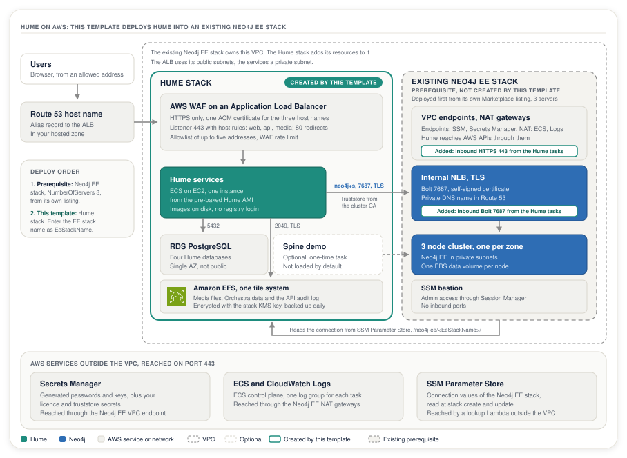

# hume-aws-cloudformation

## Overview

This repository deploys Hume, the GraphAware knowledge graph platform, on Amazon ECS with EC2 capacity. It is an early beta. One CloudFormation template builds the ECS cluster, one instance, an RDS database, the secrets and the load balancer. The template connects to a Neo4j Enterprise Edition stack that you build first. A purpose-built AMI carries the Hume images, so the running stack never logs in to a registry.

The design targets an AWS Marketplace AMI listing that runs in commercial Regions and in GovCloud. This release meets compliance level `All` only. See [Release Scope by Compliance Level](docs/compliance/release-scope.md).

**Terms**

- **Hume:** The GraphAware Hume services. The stack runs five of them as ECS services on one instance.
- **AMI:** The machine image that carries the Hume images. The scripts in `ami/` build it once, and it stays private.
- **Stack:** One CloudFormation stack that `stack/deploy.py` builds from `stack/hume-ecs.template.yaml`.
- **Record file:** The file `stack/.deploy/<stack name>.txt` that each stack writes. The scripts use it to find the stack.

**What the template builds**

- **Compute:** An ECS cluster with ENI trunking and one instance from the Hume AMI in a private subnet. The instance starts from the AMI, which already holds every Hume image.
- **Data and secrets:** One RDS for PostgreSQL instance, and Secrets Manager secrets encrypted with a customer-managed KMS key.
- **Entry point:** An application load balancer with AWS WAF. One HTTPS listener on port 443 sends `hume.<base>` to the web UI, `hume-api.<base>` to the API and `hume-media.<base>` to media. A listener on port 80 only redirects to HTTPS. The load balancer accepts traffic only from one to five single addresses that you list.
- **DNS and certificate:** The stack needs a base name in a public Route 53 hosted zone that you own, in the same account. It requests one ACM certificate for the three host names, validates it in the zone, and creates three alias records to the load balancer. A customer who keeps DNS elsewhere is not supported yet.
- **WAF:** The rate rule blocks an address that sends more than 10000 requests in five minutes. The common rule set blocks a request that matches a rule, except the body size rule, which only counts.
- **Network:** The template builds no network and no Neo4j. It runs in the VPC of the Neo4j EE stack and uses that stack's VPC endpoints and NAT gateways.
- **Template staging:** The template is larger than the 51,200 bytes that CloudFormation accepts in a direct upload. `deploy.py` stages it in a private S3 bucket and creates the stack from its URL.

**Sign-in**

Hume signs users in through the customer's OpenID Connect identity provider by default. An Amazon Cognito user pool stands in for it in tests. `Native` sign-in with one generated administrator password is the fallback. See [Identity Architecture](docs/architecture/identity.md).

**Neo4j Enterprise Edition**

- **Separate stack:** Neo4j Enterprise Edition comes from the Neo4j EE project in Private mode. That project is a separate checkout with its own `deploy.py`. It runs a 3 node cluster, one node in each availability zone, in private subnets with no public address. An internal Network Load Balancer terminates TLS in front of the nodes.
- **Private connection:** Hume joins the VPC of the Neo4j EE stack and connects to the internal load balancer with `neo4j+s` on port 7687. Hume trusts the cluster certificate through a truststore built from the trust anchor that the Neo4j stack publishes in SSM. Admins reach the cluster through a bastion over Systems Manager, with no inbound ports.
- **Requirements:** The cluster needs 3 nodes, because one node builds only one zone and Hume's public subnets then cannot be filled. Both stacks must share one AWS account and Region. The Neo4j stack must be built with `EnableInternetEgress` true, because Hume's instance reaches the ECS control plane and the identity provider through that stack's NAT gateways. The Neo4j stack must publish `kms-key-arn`, its single-Region secrets key. An older stack without it fails at `neo4j_env.py`, which names the missing value. See [Read the Neo4j values](docs/guides/run-book.md#read-the-neo4j-values).
- **Licence:** Whoever deploys Neo4j accepts the Neo4j Enterprise licence terms for the account.
- **Removal order:** Hume runs inside the Neo4j VPC and uses its VPC endpoints, so remove the Hume stack before the Neo4j EE stack.

## Main docs

[The docs index](docs/README.md) lists every guide and design document. These are the main ones.

| Document | What it covers |
|---|---|
| [Run book](docs/guides/run-book.md) | Copy-paste steps from the prerequisites and the AMI to the Neo4j EE stack, the Hume stack and the checks. |
| [Operations manual](docs/guides/operations.md) | Sign-in, the allowed addresses, template parameters, rotation and what a deploy does. |
| [Check and prove a stack](docs/guides/testing.md) | The black box check, the proofs, the browser checks and the hardening checks. |
| [Troubleshooting](docs/guides/troubleshooting.md) | Known problems, with the cause and the fix of each. |
| [Command reference](docs/reference/commands.md) | Every script, command and flag. |
| [Infrastructure setup details](docs/reference/infrastructure-setup-details.md) | What each run book step does and what Hume needs from the Neo4j EE stack. |
| [Spine demo](docs/guides/spine-demo.md) | How to load the optional Spine demo database and knowledge graph. |
| [Architecture overview](docs/architecture/architecture-overview.md) | The design in brief, with links to the network, identity and detailed architecture documents. |
| [Detailed architecture](docs/architecture/detailed-architecture.md) | What the template and AMI build, from the AMI to upgrades. |
| [Compliance documents](docs/compliance/release-scope.md) | The release scope, the GovCloud rules and federal compliance. |

## Main services

| Service | What it is | How it works |
|---|---|---|
| Foundation stack | The ECS cluster with ENI trunking, and one instance from the Hume AMI in a private subnet of the Neo4j EE VPC. | ENI trunking gives each task its own network interface on the one instance. The instance starts from the AMI, so no image is pulled when it starts. |
| Data layer, Hume services and load balancer | RDS PostgreSQL and the secrets, the five Hume services on ECS, and the HTTPS load balancer with the allowlist and AWS WAF. | The five Hume services run as ECS tasks on the one instance. The load balancer takes HTTPS on port 443, routes by host name to `web`, `api` and `media`, passes only the allowed addresses, and sits behind AWS WAF. The template is `stack/hume-ecs.template.yaml`, and one `deploy.py up` creates the whole stack. |
| Private Neo4j Enterprise | Hume in the VPC of a private 3 node Neo4j Enterprise stack, connected over `neo4j+s` with a truststore built from the cluster CA. | Hume runs in the VPC of the Neo4j EE stack. It connects to the internal load balancer over `neo4j+s`, and the truststore lets it check the cluster certificate. The steps are in [the run book](docs/guides/run-book.md). [Infrastructure setup details](docs/reference/infrastructure-setup-details.md#what-hume-needs-from-the-neo4j-stack) says what Hume needs from that stack. |
| Spine demo | An optional demo database and the SPINE knowledge graph in Hume. It is not loaded by default. `demo/spine/spine_demo.py` loads it. | `seed_nodes.py` copies the backup onto one cluster node. `spine_demo.py` then loads the `spine` database on that node over SSM, and a config import creates the SPINE knowledge graph in Hume. The steps are in [the Spine demo guide](docs/guides/spine-demo.md). |

## Quick start

Follow [the run book](docs/guides/run-book.md). It covers every step, in this order:

1. Check the prerequisites.
2. Build the AMI.
3. Build the Neo4j EE stack.
4. Build the Hume stack with `./stack/deploy.py`.
5. Check that it works.

## Layout

| Path | Contents |
|---|---|
| `ami/` | `create_ami.py` and `test_ami.py`, the build script `build.sh`, the helpers in `aws_helpers.py`, the static config in `files/` that is baked into the image, and `ami-id.txt`, which the build writes. |
| `stack/` | The CloudFormation template `hume-ecs.template.yaml`, `deploy.py`, `check_prereqs.py`, `allowlist.py`, `neo4j_env.py`, `vpn_ip_ranges.py`, and the record files in `.deploy/`. |
| `verify/` | `blackbox.py` and `prove.py`, which check and prove a deployed stack, and `cognito.py`, which builds the Cognito test pool. |
| `demo/spine/` | The Spine demo scripts `seed_nodes.py` and `spine_demo.py`, the Cypher file and the CCR data, with their own README. `hume-config/` holds the Spine knowledge graph config for Hume, copied unchanged from the hume-quickstart repo. |
| `marketplace/` | `marketplace_assets.py`, which creates the AWS Marketplace ingestion role and publishes the listing assets. |
| `tests/` | The offline tests, which make no AWS call. `helpers/` holds the shared helpers. `template/`, `stack/`, `verify/`, `demo/` and `docs/` hold the tests of the template, the scripts and the doc links. |
| `docs/` | The documents, listed in [the docs index](docs/README.md), the customer deploy guide `deploy-guide.md`, and the diagrams in `images/`. |
| `docs/guides/` | The run book and the guides for checks, operations, troubleshooting, teardown and the Spine demo. |
| `docs/reference/` | The command reference, the infrastructure setup details and the acronyms. |
| `docs/architecture/` | The architecture, network and identity documents, with `make_svg.py`, which generates the ECS pre-baked AMI diagram. |
| `docs/compliance/` | The GovCloud, federal compliance and security documents. |
| `.env.example` | The template for `.env`. |
