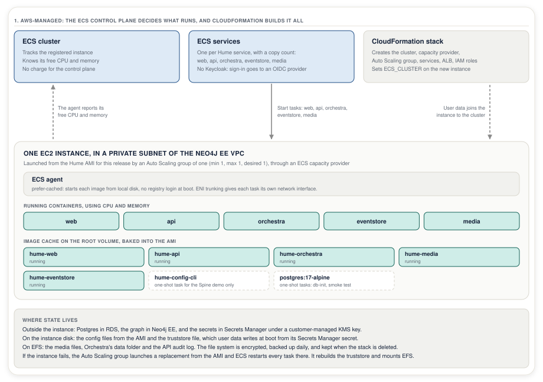

# Hume on AWS Marketplace Architecture Overview: ECS Managing Pre-Baked EC2 Instances

## Overview

Hume on AWS Marketplace runs on Amazon ECS. ECS manages EC2 instances that start from one pre-baked Hume AMI. This document describes the architecture as implemented.

- **Delivery:** Hume ships as one AWS Marketplace AMI listing with a CloudFormation template. GovCloud sells AMI products and not container products, so the template launches only the Hume AMI.
- **Compute:** ECS runs each Hume service as its own ECS service. The AMI already holds every Hume container image, so no task pulls from a registry.
- **Entry point:** An Application Load Balancer with WAF is the only way in for users.
- **Data and secrets:** RDS for Postgres holds the service data. Secrets Manager and a customer-managed KMS key hold the secrets and keys.
- **Neo4j:** Hume reaches the customer's Neo4j EE cluster over a private connection.
- **Sign-in:** Users sign in through the customer's identity provider over OIDC.
- **Compliance level:** This implementation meets compliance level `All` only. The levels above it are the roadmap. See [Release Scope by Compliance Level](../compliance/release-scope.md) and [Federal Compliance](../compliance/federal-compliance.md#compliance-levels).

## Contents

1. [Deployment Architecture](#deployment-architecture-ecs-managing-pre-baked-ec2-instances)
2. [One Deployment for Commercial and GovCloud](#one-deployment-for-commercial-and-govcloud)
3. [Why This Design Fits AWS Guidance for GovCloud](#why-this-design-fits-aws-guidance-for-govcloud)
4. [Known Tradeoffs](#known-tradeoffs)
5. [Related Documents](#related-documents)

## Deployment Architecture: ECS Managing Pre-Baked EC2 Instances

AWS Marketplace in GovCloud does not sell container products. It sells AMI-based products and SaaS products, and a SaaS listing would mean GraphAware runs Hume instead of the customer. An AMI listing's template may launch only the product's own AMI or an AWS-managed AMI. The [GovCloud Requirements](../compliance/gov-cloud.md#constraints-that-set-the-delivery-model) document lists the sources for these constraints.

Given that GovCloud limits the deployment to an AMI, the architecture is ECS managing EC2 instances launched from a pre-baked Hume AMI. Hume ships as one AWS Marketplace AMI listing with a CloudFormation template. The AMI is the Amazon ECS-optimized Amazon Linux 2023 AMI with the Hume container images already on its disk, so a customer deployment never contacts a container registry. Hume keeps its container images and its service layout, and ECS runs each service as its own ECS service.

1. **Hume AMI:** GraphAware builds one AMI for each Hume release and each base OS patch. It starts from the ECS-optimized image and adds every Hume container image to the disk. It carries the ECS agent settings that make ECS use those images, and no secrets or customer settings. An instance launched from it downloads nothing.
2. **ECS cluster on an Auto Scaling group:** The template runs one instance from that AMI in a private subnet. The Auto Scaling group replaces the instance if it fails, and an ECS capacity provider links the group to the cluster. Two instances in two Availability Zones is a next step.
3. **ECS control plane:** AWS runs the control plane and charges nothing for it. It holds the list of Hume services and how many copies of each should run, picks an instance with room for each copy, and restarts a copy on a healthy instance when a task or instance fails. The ECS agent on each instance reports its free CPU and memory and starts containers from the image cache on its disk. See [ECS Agent Settings](detailed-architecture.md#ecs-agent-settings).
4. **Hume services:** Each Compose service becomes an ECS service with its own task definition. Services call each other by private DNS names in an AWS Cloud Map namespace, such as `orchestra.hume.local`, which replace the container names that Docker Compose resolves today.
5. **Application Load Balancer and WAF:** The ALB is the only entry point. WAF filters each request, and the ALB routes it to `web`, `api`, or `media`. The rest of the cluster has no inbound path from users.
6. **RDS for Postgres:** One single-AZ instance replaces the four Postgres containers. `api`, `orchestra`, `eventstore`, and `media` each keep their records in their own database.
7. **Media files:** The media service stores uploaded files on an Amazon EFS file system, so they survive an instance replacement. The stack keeps the file system when it is deleted, and a new stack can adopt it. Orchestra's `/data` folder and the API audit logs use the same file system. Moving media to an S3 bucket encrypted with the deployment's KMS key is a next step.
8. **Secrets Manager and KMS:** The template generates the database and service passwords at deploy time and stores them in Secrets Manager. The deploy script generates the encryption master key and stores it there too. A customer-managed KMS key encrypts the secrets and the database, and CloudTrail logs each use of the key.
9. **Neo4j EE:** The customer deploys Neo4j EE first, from the Neo4j EE Private template with three nodes. The Hume template builds only the private connection to it.

Docker Compose does this same job on one server. ECS does it on the cluster and restarts a failed task without an operator.

## One Deployment for Commercial and GovCloud

Hume has a single deployment: one AMI listing and one template, used in commercial Regions and in both GovCloud Regions. An AMI listing lets the seller choose its Regions, so the same listing turns on both. The template builds every ARN with `${AWS::Partition}` and uses no service that GovCloud lacks, so it launches in either. GraphAware builds, tests, scans, prices, and supports one product. Every stack so far has run in `us-east-1` in a commercial account. See the GovCloud test account checks in [To Verify in a GovCloud Test Account](../compliance/federal-compliance.md#to-verify-in-a-govcloud-test-account).

## Why This Design Fits AWS Guidance for GovCloud

The design builds on AWS guidance for GovCloud, for AWS Marketplace, and for ECS.

1. **GovCloud runs containers:** ECS runs in both GovCloud Regions. The GovCloud limit is in the Marketplace catalog. See [Amazon ECS in AWS GovCloud (US)](https://docs.aws.amazon.com/govcloud-us/latest/UserGuide/govcloud-ecs.html).
2. **The AMI policy allows it:** The [AMI-based product requirements](https://docs.aws.amazon.com/marketplace/latest/userguide/product-and-ami-policies.html) judge an AMI on security scans, supported software, credentials, and delivery.
3. **AMI listings can build clusters:** AWS Marketplace says a CloudFormation template on an AMI listing can "define a cluster or distributed architecture." It recommends an Auto Scaling group and says a new node should join the running cluster on its own. See [Add CloudFormation templates to your product](https://docs.aws.amazon.com/marketplace/latest/userguide/cloudformation.html).
4. **AWS documents both building blocks:** AWS has a tutorial for building custom ECS-optimized AMIs with EC2 Image Builder. See [Using EC2 Image Builder to build customized Amazon ECS-optimized AMIs](https://docs.aws.amazon.com/AmazonECS/latest/developerguide/image-builder-tutorial.html). The ECS agent setting `ECS_IMAGE_PULL_BEHAVIOR=prefer-cached` uses an image already on the instance and keeps it out of automated cleanup. See [Container image pull behavior](https://docs.aws.amazon.com/AmazonECS/latest/developerguide/pull-behavior.html).
5. **Immutable servers:** Patches and upgrades replace whole instances with new ones built from a new AMI. AWS recommends this pattern in [REL08-BP04 Deploy using immutable infrastructure](https://docs.aws.amazon.com/wellarchitected/latest/framework/rel_tracking_change_management_immutable_infrastructure.html).

## Known Tradeoffs

These tradeoffs come with the architecture and stay in this release.

1. **Every release is an AMI:** A registry-based release changes an image tag. This design needs a new AMI, a Marketplace review, and an instance refresh for every Hume release and every OS patch.
2. **The customer runs instances:** The customer's account holds EC2 instances that need sizing, patching through new AMI versions, and capacity headroom.
3. **Marketplace review is unproven:** The policy permits the pattern, but we have not found a listing that documents an ECS cluster built from preloaded images. The listing has not been submitted yet, and a rejection would be costly.
4. **Image scan coverage is unclear:** It is unclear whether the Marketplace AMI scan and Amazon Inspector look inside container image layers stored on the instance. Agencies may ask for separate image scan reports.
5. **Single points of failure:** The stack runs one instance and a single-AZ RDS instance. Hume is down while the Auto Scaling group replaces the instance, and the database is down if its zone fails. A service that runs one copy is down while ECS restarts it.
6. **Seller requirements:** The GovCloud seller requirements apply to whichever company publishes the listing. See [GovCloud Requirements](../compliance/gov-cloud.md#govcloud-marketplace-restrictions).

## Related Documents

These documents hold the detail that this overview leaves out.

**Architecture**

- **[Network Architecture](network-architecture.md):** The network rules, the entry point, the private connection to Neo4j EE and the egress path.
- **[Network Design](network-design.md):** The subnet layout, host routing, security group rules, VPC endpoints and a traffic walkthrough.
- **[Identity Architecture](identity.md):** The OIDC login, the Neo4j sign-in flows and the Neo4j roles.
- **[Detailed Architecture](detailed-architecture.md):** What the current template and AMI build, from the AMI to upgrades.

**Compliance**

- **[Release Scope by Compliance Level](../compliance/release-scope.md):** What this release covers and what the roadmap adds.
- **[GovCloud Requirements](../compliance/gov-cloud.md):** The GovCloud rules that apply to every deployment.
- **[Federal Compliance](../compliance/federal-compliance.md):** Every compliance level above `All`, with its open decisions.
- **[Neo4j EE Compliance Findings](../compliance/ee-compliance.md):** How Neo4j Enterprise Edition measures against the federal requirements.
- **[Acronyms](../reference/acronyms.md):** The acronyms used across the documents.
