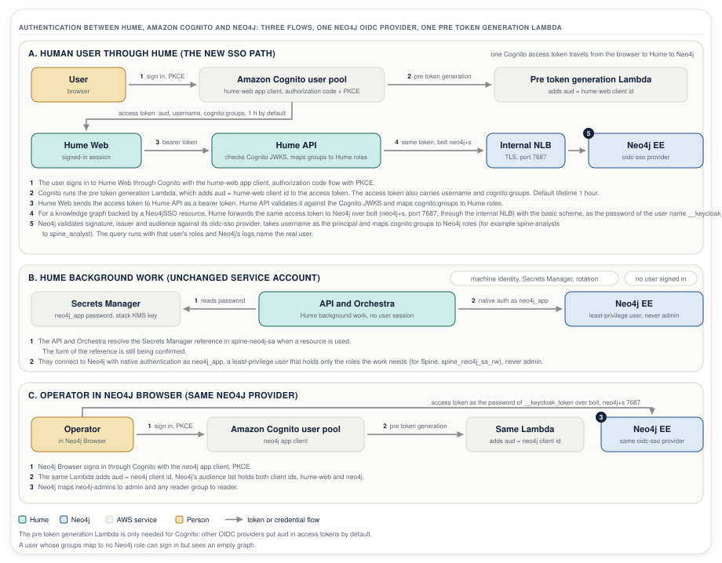
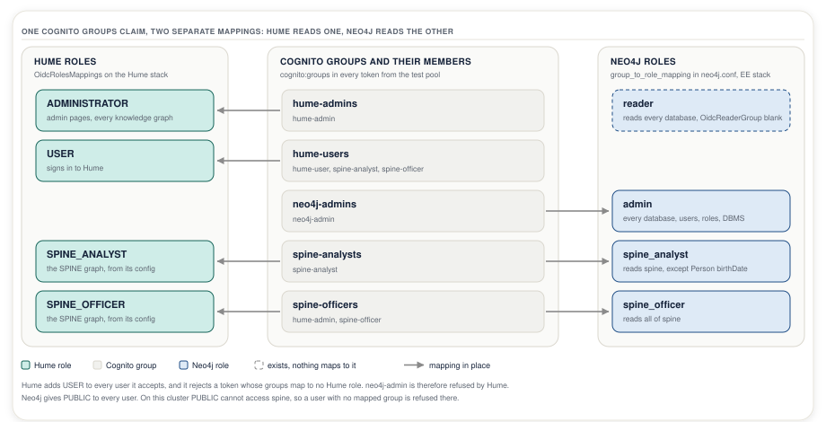
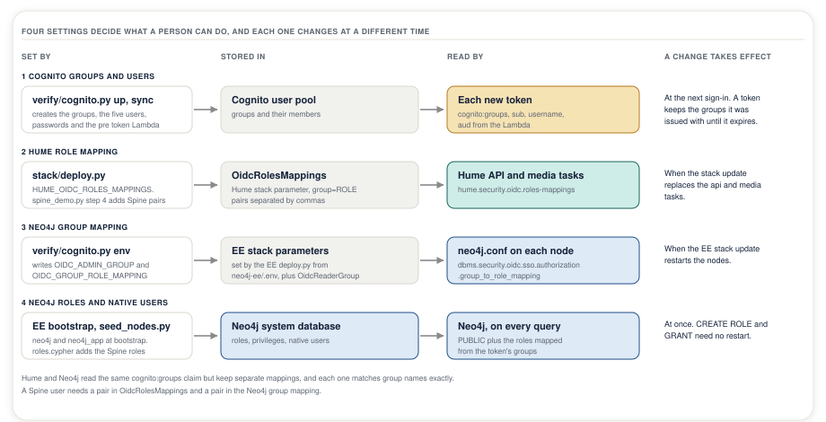

# Identity Architecture

This document covers how users sign in to Hume and how Hume signs in to Neo4j EE.

## Direct OIDC Login

Applies to: `All` for single sign-on, `Federal` for PIV and phishing-resistant MFA.

Users sign in through the customer's own identity provider over OIDC. Hume keeps no accounts of its own, which is what [OMB M-22-09](../compliance/federal-compliance.md#federal-zero-trust-rules-omb-m-22-09) asks of federal agencies.

1. **Settings:** The API and the media service set `hume.security.provider=oidc`, with `hume.security.oidc.issuer-uri` and `hume.security.oidc.client-id` naming the provider. Hume reads roles from the JWT claim named by `hume.security.oidc.roles-claim-paths`, and `hume.security.oidc.roles-mappings` maps provider roles to Hume roles, such as `provider-admin=ADMINISTRATOR`. Entra app roles arrive in the `roles` claim. See the Hume Generic OIDC Provider Support guide.
2. **First administrator:** The provider group that maps to `ADMINISTRATOR` gives its users the admin role, so Hume needs no bootstrap password. A live test on 2026-11-05 showed that the API creates no local administrator under OIDC.
3. **PIV and phishing-resistant MFA:** The identity provider checks PIV and CAC cards and enforces phishing-resistant MFA. Hume reads the signed token and does not read smart cards.
4. **Outbound access:** The API and the media service call the provider server to server, to fetch signing keys and exchange login codes for tokens. A cloud provider such as Okta or Microsoft Entra ID sits on the internet, and those calls leave through the Neo4j EE stack's NAT gateways today. See [Egress and AWS Service Access](network-architecture.md#egress-and-aws-service-access).
5. **Implemented:** The template signs users in through OIDC by default, with `Native` sign-in as a fallback. An Amazon Cognito pool stands in for the customer's provider in tests.

## Hume to Neo4j Over SSO

Hume splits its Neo4j traffic by who is behind it. When a person uses Hume, Hume forwards that person's sign-in token to Neo4j. Neo4j checks the token, names the person in its logs and applies the roles mapped to that person's groups. When no person is behind the work, Hume signs in as the application user `neo4j_app`, whose password lives in Secrets Manager. Neo4j therefore sees each person rather than one shared user, which is what FedRAMP's individual accountability and the Well-Architected split between human and machine identity ask for. The design has run end to end on the live stacks since 2026-11-05. The notes on the token, the principal claim and the Hume jar findings are in [the detailed architecture](detailed-architecture.md#hume-to-neo4j-over-sso), and the proof is in [Check and prove a stack](../guides/testing.md#check-hume-reaches-neo4j-over-sso).

### How the Flows Work

Three flows share one Neo4j OIDC provider. Neo4j's audience list holds both Cognito client ids, so Hume's forwarded token and Browser's own token both pass.

1. **A person in Hume:** Hume forwards the user's own token, so Neo4j runs the query as that user.
    - The user signs in to Hume Web through Cognito with the `hume-web` client. A Cognito trigger adds `aud` to the access token, which also carries `username` and `cognito:groups`.
    - Hume Web sends that token to the Hume API, which validates it and maps the groups to Hume roles.
    - For a knowledge graph on a `Neo4jSSO` resource, Hume forwards the same token to Neo4j over Bolt with the basic scheme, as the password of the fixed user `__keycloak_token`.
    - Neo4j checks the signature, issuer and audience, takes `sub` as the principal, maps `cognito:groups` to roles and runs the query as that user.
    - Neo4j's logs show the user's Cognito id and Hume's audit log shows the user name from the same token, so one lookup in the provider ties the two together.
2. **Hume background work:** Work with no person behind it uses the application user.
    - The service account resource `spine-neo4j-sa` holds a Secrets Manager reference to the `neo4j_app` secret. The API and Orchestra resolve the reference when a resource is used, and they connect with native authentication. The form of the reference is still being confirmed.
    - Hume keeps its own data in RDS, so no migration or bootstrap touches Neo4j.
    - `neo4j_app` holds `architect` and `PUBLIC`. It never holds `admin`.
3. **An operator in Neo4j Browser:** Browser signs in through the same provider with its own client.
    - Browser signs in through Cognito with the `neo4j` client, and the same trigger adds `aud` for that client.
    - The `neo4j-admins` group maps to `admin`.

### Neo4j Roles

Three kinds of principal sign in to the EE cluster. The table lists each one, how it signs in, the roles it holds and where that is defined.

| Principal | How it signs in | Roles | Defined in |
|---|---|---|---|
| `neo4j` | Native, with the admin password the EE stack keeps in Secrets Manager. The EE stack's own bootstrap uses it, and `seed_nodes.py` uses it on the seed node over SSM to restore the Spine backup and run `roles.cypher`. Hume never holds it. | `admin` | The EE template |
| `neo4j_app` | Native, with the password the EE stack generates and keeps in Secrets Manager. The stack's `create-app-user` step creates the user with it. Hume reads it for every resource that is not `Neo4jSSO`: the Main perspective and `spine-neo4j-sa`. | `architect`, granted by the EE bootstrap, plus `PUBLIC`, which Neo4j gives every user | The EE template, decision AD-6 in `neo4j-ee/docs/architecture/template-architecture.md` |
| A signed-in person | The token Hume forwards, or the token Neo4j Browser obtains. Neo4j takes `sub` as the principal and maps `cognito:groups` to roles. | `neo4j-admins` gives `admin`. `spine-analysts` gives `spine_analyst`. `spine-officers` gives `spine_officer`. Any other group, or no group, gives `PUBLIC` only on this stack, because `OidcReaderGroup` is blank. That parameter can map one group to `reader`. | `OIDC_ADMIN_GROUP` and `OIDC_GROUP_ROLE_MAPPING`, read from `neo4j-ee/.env` by the EE `deploy.py`. Hume generates them in `stack/.deploy/.env.neo4jee`. |

The two native users hold roles granted at bootstrap. A signed-in person holds roles only through the group mapping, because `sub` changes if the pool is recreated, so nothing is granted to a specific principal. A person whose groups map to no role still signs in, with `PUBLIC` alone.

- **Built-in roles:** Neo4j ships six roles. `PUBLIC` belongs to every user and, on this cluster, allows access to the home database with no read privilege, so a user with `PUBLIC` alone sees an empty graph and is refused on `spine`. `reader` reads. `editor` changes data within the existing schema, `publisher` can also add labels and property keys, `architect` adds index and constraint management and `admin` adds user, role and database administration. See the [operations manual](https://neo4j.com/docs/operations-manual/current/authentication-authorization/built-in-roles/).
- **Spine roles:** `demo/spine/roles.cypher` creates three roles on the `spine` database. `spine_analyst` reads everything except `birthDate` on Person nodes. `spine_officer` reads everything. `spine_neo4j_sa_rw` has every privilege on `spine`, and no user holds it. The [Spine demo page](../guides/spine-demo.md#roles) covers the Hume-side roles that pair with them.
- **Why `neo4j_app` keeps `architect`:** Hume signs in with one service account for every password-based resource, so that account must cover whatever a customer's Hume configuration does. Perspectives and alerting patterns read, and Orchestra `Neo4jWriter` steps run whatever Cypher the workflow author writes, including schema changes. `architect` is the smallest built-in role that covers reads, writes and schema changes on every database without administration. `spine_neo4j_sa_rw` would fit the Spine demo alone and would break a customer workflow that writes elsewhere. The team confirmed on 2026-11-05 that `architect` stays, and a read-only option is left for a later release. A leaked `neo4j_app` password cannot create users, change roles or drop databases, but it can write data and change indexes and constraints on every database.

## Users, Groups and Roles

A person's rights come from two mappings that read the same token. Hume reads `cognito:groups` and maps each group to a Hume role through `OidcRolesMappings`. Neo4j reads the same claim and maps each group to a Neo4j role through `group_to_role_mapping`. The two mappings are separate on purpose, so one group can grant a Hume role, a Neo4j role, both or neither. A user who should see a knowledge graph on a `Neo4jSSO` resource needs both. The Hume role makes the graph visible in Hume, and the Neo4j role lets the forwarded query run.

The visualization failure of 2026-11-09 shows what happens when only one side is mapped. `hume-admin` held `ADMINISTRATOR`, so Hume showed the SPINE graph. Its only group mapped to no Neo4j role, so Neo4j ran each query with `PUBLIC` alone and refused it on `spine`.

The diagram reads from the middle out. Each Cognito group in the center lists its members. An arrow to the left is a pair in `OidcRolesMappings`, and an arrow to the right is a pair in the Neo4j group mapping.

- **Both sides:** `spine-analysts` and `spine-officers` are the only groups mapped on both sides, so their members can use the Spine visualizations.
- **One side only:** `hume-admins` maps only to Hume and `neo4j-admins` maps only to Neo4j. That split keeps a Hume administrator apart from a Neo4j superuser.

### Cognito Groups

`verify/cognito.py` creates these five groups in the test pool. The Hume pairs for the Spine groups exist once `spine_demo.py` step 4 adds them. Without that step, `OidcRolesMappings` holds its default, `hume-admins=ADMINISTRATOR,hume-users=USER`.

| Group | Members set by `cognito.py` | Hume role | Neo4j role | Purpose |
|---|---|---|---|---|
| `hume-admins` | `hume-admin` | `ADMINISTRATOR` | None | Hume administration. The group grants no data in Neo4j. |
| `hume-users` | `hume-user`, `spine-analyst`, `spine-officer` | `USER` | None | Hume sign-in. Hume rejects a token whose groups map to no Hume role, so every Hume user needs a mapped group. |
| `neo4j-admins` | `neo4j-admin` | None | `admin`, through `OIDC_ADMIN_GROUP` | Cluster administration in Neo4j Browser. |
| `spine-analysts` | `spine-analyst` | `SPINE_ANALYST` | `spine_analyst` | The Spine demo without Person `birthDate`. |
| `spine-officers` | `hume-admin`, `spine-officer` | `SPINE_OFFICER` | `spine_officer` | The Spine demo with every property. |

### Users

The table lists every principal that signs in to Hume or Neo4j. The first five are Cognito users, each with a password in Secrets Manager under `hume/hume-test-idp/cognito/<user>`. The last two are the native Neo4j users that [Neo4j Roles](#neo4j-roles) covers in detail.

| User | Signs in to | Cognito groups | Hume roles | Neo4j roles | What it can do |
|---|---|---|---|---|---|
| `hume-admin` | Hume | `hume-admins`, `spine-officers` | `USER`, `ADMINISTRATOR`, `SPINE_OFFICER` | `spine_officer`, `PUBLIC` | Administers Hume and sees every knowledge graph. A Spine action through `spine-neo4j-sso` runs as `spine_officer` and reads every property. The user holds no Neo4j superuser role. The Main perspective signs in as `neo4j_app`. |
| `hume-user` | Hume | `hume-users` | `USER` | `PUBLIC` | Signs in to Hume. Hume hides the SPINE graph. |
| `spine-analyst` | Hume | `hume-users`, `spine-analysts` | `USER`, `SPINE_ANALYST` | `spine_analyst`, `PUBLIC` | Reads Spine with `Birth Date` empty. |
| `spine-officer` | Hume | `hume-users`, `spine-officers` | `USER`, `SPINE_OFFICER` | `spine_officer`, `PUBLIC` | Reads all of Spine. |
| `neo4j-admin` | Neo4j Browser | `neo4j-admins` | None. Hume rejects the token. | `admin`, `PUBLIC` | Administers the cluster. |
| `neo4j` | Neo4j, native password | None | None | `admin` | Runs the EE bootstrap and the `seed_nodes.py` load. Hume never holds it. |
| `neo4j_app` | Neo4j, native password | None | None | `architect`, `PUBLIC` | Runs Hume background work and every resource that is not `Neo4jSSO`. |

Hume adds `USER` to every user it accepts, which is why `hume-admin` holds it without being in `hume-users`. Neo4j adds `PUBLIC` to every user. On this cluster `PUBLIC` can reach the home database but not `spine`.

### Why Each User Exists

Each user stands for one kind of person, and each one tests a different part of the design.

- **`hume-admin`:** This user is the Hume administrator. It shows that a person can run Hume without being a Neo4j superuser. Its Spine reads run under its own `spine_officer` role over SSO.
- **`hume-user`:** This user is an ordinary person who signs in to Hume and has no data access. It is the negative test. It shows that a Hume sign-in alone does not open the Spine data. Hume refuses it first, so through Hume it never reaches Neo4j. On 2026-11-13 the Hume API returned 403 for the SPINE graph. When the user connected straight to Neo4j with its own token, Neo4j signed it in with `PUBLIC` only and refused the `spine` database.
- **`spine-analyst`:** This user is a Spine reader with restricted access. It shows that Neo4j applies a property rule to the person who runs the query. `Birth Date` comes back empty, while `neo4j_app` reads every property.
- **`spine-officer`:** This user is a Spine reader with full access who is not a Hume administrator. It holds the same Spine roles as `hume-admin` without `ADMINISTRATOR`. No test plan uses it yet.
- **`neo4j-admin`:** This user is the Neo4j administrator. It manages users, roles, databases and the cluster in Neo4j Browser or cypher-shell. Hume rejects its token, which keeps Neo4j administration apart from Hume administration.
- **`neo4j`:** This user is the bootstrap account. It sets up the cluster and loads the seed data. Hume never holds it.
- **`neo4j_app`:** This user is Hume's service account. It runs background work and every resource that does not sign in over SSO, such as the Main perspective and scheduled workflows.

### The Live Pool Matches the Design

On 2026-11-09 the visualization fix added `hume-admin` to `neo4j-admins`, which made it a Neo4j `admin`. On 2026-11-11 that membership was removed and `hume-admin` joined `spine-officers`, as `cognito.py` creates it. `hume-admin` reads Spine as `spine_officer` and holds no superuser role.

`cognito.py sync` adds only the groups and users a pool lacks. A pool built before this change needs the same two membership changes by hand.

### How the Setup Fits Together

Four settings decide what a person can do. A different script owns each one, and each change takes effect at a different moment.

1. **Cognito groups and users:** `verify/cognito.py up` creates the pool, the groups, the users and their memberships, and `sync` adds whatever a pool lacks. Cognito writes the groups into each token it issues. A membership change therefore reaches Hume and Neo4j only when the user signs in again.
2. **Hume role mapping:** `stack/deploy.py` passes `HUME_OIDC_ROLES_MAPPINGS` to the Hume stack as `OidcRolesMappings`, and `spine_demo.py` step 4 adds the Spine pairs. The API and media tasks read the value at start. A change replaces those tasks.
3. **Neo4j group mapping:** `verify/cognito.py env` writes `OIDC_ADMIN_GROUP=neo4j-admins` and `OIDC_GROUP_ROLE_MAPPING=spine-analysts=spine_analyst;spine-officers=spine_officer` into `stack/.deploy/.env.neo4jee`. The EE `deploy.py` reads them from `neo4j-ee/.env`, and the EE stack joins them into one `group_to_role_mapping` line in `neo4j.conf` on each node. The nodes read that file at start, so a change needs an EE stack update and a restart. `cognito.py env` does not write `OIDC_READER_GROUP`, so `OidcReaderGroup` stays blank.
4. **Neo4j roles:** The EE bootstrap creates `neo4j` and `neo4j_app`. `demo/spine/seed_nodes.py` runs `demo/spine/roles.cypher`, which creates the Spine roles. A role or privilege change applies at once.

Both mappings follow the same two rules.

- **Exact names:** Each mapping matches group names exactly. When `group_to_role_mapping` is set, Neo4j maps only the groups it lists, and a role that shares a group's name gets nothing from it.
- **Unmapped groups:** Each side ignores a group with no pair. Hume then rejects a user with no mapped group at all. Neo4j still signs that user in, with `PUBLIC` alone.

Giving a user access to a knowledge graph on a `Neo4jSSO` resource takes a group with a pair on each side, a Neo4j role with access to the database, and a fresh sign-in. For Spine, `spine-analysts` and `spine-officers` already have both pairs and both roles.
