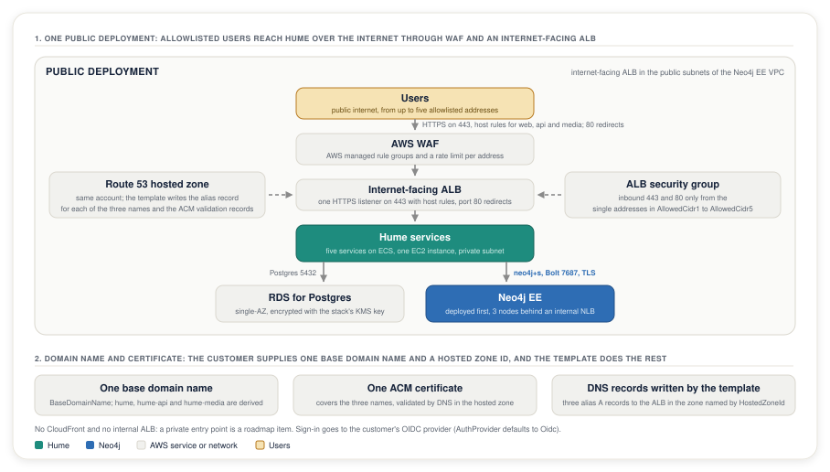
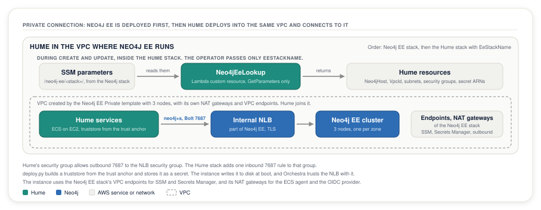

# Network Architecture

This document covers the network choices that shape the design. The [Network Design](network-design.md) document holds the subnet layout, host routing, security group rules, VPC endpoints, and a traffic walkthrough.

## Design Guidance

Five rules drive every network choice.

1. **One way in:** The ALB is the only resource that accepts connections from users. Instances, tasks, RDS, and Neo4j have no public IP addresses and no inbound rules from outside the VPC.
2. **No registry at runtime:** The Hume images are on the AMI, so no task pulls an image. The VPC needs no route to ECR, Docker Hub, or `docker.graphaware.com`.
3. **AWS APIs over private endpoints:** Hume reaches Systems Manager and Secrets Manager through the Neo4j EE stack's interface VPC endpoints. The ECS agent and CloudWatch Logs leave through that stack's NAT gateways today. Reaching every AWS API over an endpoint is a next step. See [Egress and AWS Service Access](#egress-and-aws-service-access).
4. **Security groups, not CIDR ranges:** Each ECS task has its own network interface, and the template gives the instance and every task one shared security group. Rules name other security groups, not CIDR ranges, wherever both ends are inside the VPC. The [Network Design](network-design.md#service-to-service-traffic-and-security-groups) lists the three groups and their rules.
5. **TLS on every hop:** OMB M-22-09 requires authenticated HTTPS inside the VPC as well as at the edge. This release ends TLS at the load balancer. The [Encryption in Transit](detailed-architecture.md#encryption-in-transit) table shows which hops are encrypted today, and [HTTPS Inside the VPC](../compliance/federal-compliance.md#https-inside-the-vpc) holds the options.

## Network Entry Point

OMB M-22-09 tells agencies to treat every application as internet-facing, whether or not it is. Login, MFA, TLS, WAF, and patching are therefore the same in every network shape, and the network is an extra layer rather than the security boundary. This release builds the public shape. The private shape is a roadmap item. See [Federal Compliance](../compliance/federal-compliance.md#federal-zero-trust-rules-omb-m-22-09).

1. **Public shape:** An internet-facing ALB sits in the public subnets of the Neo4j EE VPC, with WAF in front of it. Commercial customers and civilian agencies that publish Hume to their users use this shape.
2. **Allowlist:** The ALB security group admits up to five IPv4 ranges, one per `AllowedCidr` parameter. On 2026-11-05 the first release took single addresses only. On 2026-11-14 the team chose to accept ranges, including `0.0.0.0/0`. A stack open to the internet must use OIDC sign-in. A private shape waits for a later release. See [Entry Point](network-design.md#entry-point).
3. **HTTPS listener:** The ALB has one HTTPS listener on port 443 with host rules for `hume.<base>`, `hume-api.<base>` and `hume-media.<base>`. A port 80 listener only redirects to port 443. A request for any other host gets a fixed 403. The listener uses the certificate the template requests from ACM. The team chose this layout on 2026-11-05.
4. **WAF at the edge:** A web ACL with AWS managed rule groups attaches to the ALB. The common rules block, except the body size rule, which counts. GovCloud has no CloudFront and no Shield Advanced, so the ALB and WAF are the whole edge. See [GovCloud Requirements](../compliance/gov-cloud.md#denial-of-service-protection-nist-sc-5).

The listener, target group, and routing details are in [Network Design](network-design.md#entry-point).

### Hostname, Certificate, and DNS

The template takes one base domain name and the ID of a Route 53 hosted zone in the same account. It derives `hume.<base>`, `hume-api.<base>` and `hume-media.<base>`, requests one certificate for the three names from ACM with DNS validation, writes the validation records into the zone, and creates one alias record per name that points at the ALB. This suits our own trial stacks.

1. **Hostnames fixed at deploy time:** Hume uses its public URLs for login redirects and links. Changing the name later needs a stack update and a check of Hume's URL settings.
2. **Later release, a certificate ARN path:** Many customers keep DNS in a central account or with another provider, and in GovCloud a Route 53 alias record cannot point at a resource outside GovCloud. The customer will pass the ARN of an ACM certificate, the template will create no Route 53 resources, and the customer will add one CNAME record. Deferred on 2026-11-05.
3. **One hostname per service:** GraphAware prefers a hostname per service on port 443, such as `hume.<base>`, `hume-api.<base>`, and `hume-media.<base>`, with ALB host rules and one certificate that covers all three. The template builds that shape since 2026-11-05.

### Roadmap: Private Shape and Port 443

These items are designed and not built.

1. `DoD IL4/5` **Private shape:** A template parameter would choose an internal ALB in the private app subnets, reached over the customer's own network: a site-to-site VPN, Direct Connect, or a Transit Gateway attachment. Both shapes would use the same cluster, services, data stores, listener rules, and target groups. DoD IL4 and IL5 customers must use this shape, because their traffic may not cross the public internet. See [Federal Compliance](../compliance/federal-compliance.md#requirements-for-the-mission-owner).
2. `DoD IL4/5` **Private certificate and DNS:** The certificate would come from ACM Private CA or the customer's own CA and be imported into ACM. The customer's internal DNS would add a CNAME record for each hostname that points it at the internal ALB's DNS name. AWS publishes internal ALB names in public DNS, and they resolve to private IP addresses, so no private hosted zone is needed. The ALB security group would take a parameter for the client CIDR ranges allowed to reach port 443. AWS Client VPN is only for GraphAware's own testing.
3. `Federal` `CMMC` **FIPS TLS policy:** Port 443 carries all traffic and port 80 only redirects to 443 since 2026-11-05. The listener would use a FIPS TLS policy in GovCloud. See [Federal Compliance](../compliance/federal-compliance.md#fips-validated-cryptography).

## Connection to Neo4j EE

### Why the Connection Is Private

Hume reaches Neo4j EE only over private AWS networking, for four reasons.

1. **TLS protects the wire, not the database:** `neo4j+s` encrypts every byte in transit, so eavesdropping is not the risk. The risk is what sits behind the port. An authenticated Bolt session has full read and write access to the graph, so on a public endpoint a password and the Bolt server's own code are the only barriers.
2. **An open port invites attack:** An internet-facing Bolt port draws scanning, password guessing, and floods. A private endpoint removes that whole class of attack instead of defending against it.
3. **The authorization boundary:** FedRAMP, ITAR, and IL4 or IL5 expect the data to stay inside the authorized boundary. A public Bolt endpoint moves it outside.
4. **The Neo4j templates agree:** The Neo4j EE Public template, which exposes Bolt on an internet-facing NLB, is documented for evaluation only and does not fit. The Private and Existing VPC templates put Neo4j behind an internal NLB with TLS on the Bolt port, 7687. Neither creates a PrivateLink endpoint service.

### VPC Layout

Because the connection is private, Hume deploys into the VPC where Neo4j EE runs.

1. **The VPC:** The Neo4j EE Private template with three nodes created the VPC. Only that template publishes the public subnets Hume needs, so a single node stack and the Existing VPC template do not work. The Neo4j stack must be built with internet egress on, because Hume uses its NAT gateways. See [Egress and AWS Service Access](#egress-and-aws-service-access).
2. **Template parameter:** The customer passes the Neo4j EE stack name, `EeStackName`.
3. **Neo4j EE stack lookup:** The `Neo4jEeLookup` custom resource runs a Lambda function during create and update. It reads the values the Neo4j EE stack publishes in SSM Parameter Store under `/neo4j-ee/<EeStackName>/`, such as the VPC, the subnets, the NLB security group and the password secret ARN. It fails the create with a clear message if the stack does not exist or has one server. The truststore is the one value the customer builds, from the trust anchor in `ca-pem`. See [Commands](../reference/commands.md#neo4j_envpy).
4. **Separate VPCs:** A customer who wants Hume in another VPC would connect the two with VPC peering or a Transit Gateway and add Hume's VPC CIDR to the Neo4j `AllowedCIDR` parameter. That networking belongs to the customer, the Hume template does not build it, and it is untested.

The Hume template does not create a VPC. The VPC must have DNS resolution and DNS hostnames turned on, because both the interface endpoints and the Cloud Map namespace rely on the Amazon-provided DNS server.

The connection works as follows.

1. **Bolt with TLS:** Orchestra and the API connect to the Neo4j NLB on port 7687 with TLS and full certificate checks, using the `neo4j+s` scheme. The `neo4j+ssc` scheme skips certificate checks, so it is not used.
2. **Hostname check:** Both services trust the NLB certificate through one truststore built from the trust anchor the Neo4j EE stack publishes in SSM. The deploy script stores the truststore in Secrets Manager, the instance writes it to disk at boot, and the Orchestra and API tasks mount it. A write from Hume to the cluster is untested.
3. **Security groups:** Hume's security groups allow outbound TCP 7687 to the Neo4j NLB security group. The NLB security group allows inbound 7687 from them.

## Egress and AWS Service Access

The Hume template builds no NAT gateway and no VPC endpoints of its own. See [Network Design](network-design.md#aws-service-access).

1. **Nothing to download:** The images, OS patches, and ECS agent updates all arrive as new AMI versions, so no task pulls from a registry.
2. **The Neo4j EE stack supplies egress today:** Hume's instance sits in that stack's private subnets and has no route of its own. It uses the Neo4j NAT gateways for the ECS agent, CloudWatch Logs, and the identity provider, and the Neo4j VPC endpoints for Systems Manager and Secrets Manager. Without internet egress on the Neo4j stack, the ECS agent never registers and the Hume stack fails to create.
3. **Next step, endpoints by default with an optional NAT gateway:** The design calls for VPC endpoints for every AWS API Hume uses, and a NAT gateway parameter that is off by default. The parameter would serve customers that need outbound access beyond the VPC, such as to a cloud identity provider, an SMTP server, or systems that Orchestra workflows call. Agency networks usually supply their own egress, such as a Transit Gateway route to an inspection VPC or a TIC, and would leave the parameter off.
4. **Local finding, egress seen on a quickstart:** On 2026-11-12 a local quickstart of Hume 3.2.0 ran for about 25 minutes through a first boot, a restart and a licence check. This is a local result, and no AWS stack has been captured.
    - **API:** The API made no outbound connection and no external DNS lookup. The licence check is not among the calls recorded below.
    - **Event store:** The event store sent Liquibase anonymous analytics at startup. The hosts were `config.liquibase.com`, which goes through `gateway.scarf.sh` to an AWS load balancer in us-west-2, and `config-endpoint.liquibase.com`, which sits on Cloudflare at 104.20.24.227. The Hume template now sets `LIQUIBASE_ANALYTICS_ENABLED=false` on the event store to turn these calls off. No capture has yet shown that the setting stops them.
    - **Neo4j:** The quickstart's Neo4j sent usage data to `udc.neo4j.com` once, about 10 minutes after it started. The EE cluster runs Neo4j too, and a capture on it would show whether it does the same. The setting `dbms.usage_report.enabled` turns this report off. The Neo4j EE templates document that setting and do not set it.
    - **Keycloak:** Keycloak made the same two Liquibase calls during its first migration. The quickstart uses Keycloak and the AWS stack uses Cognito, so this call stays local.
    - **Ports and resolvers:** Every connection used port 443, and no service used an external DNS resolver.
5. **Map tiles come from the buyer's browser:** The Hume map view fetches tiles from `tile.openstreetmap.org` in the user's browser, so the stack needs no route for them. A buyer whose browsers have no internet access can point the Geospatial setting at an internal tile server.
